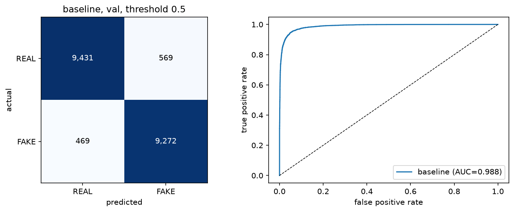
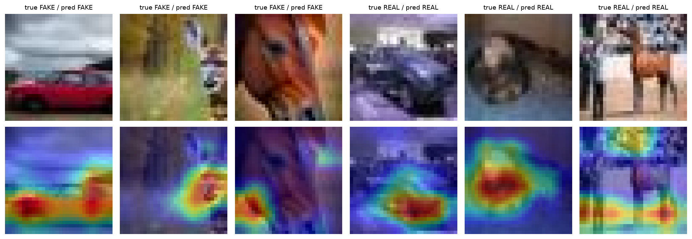
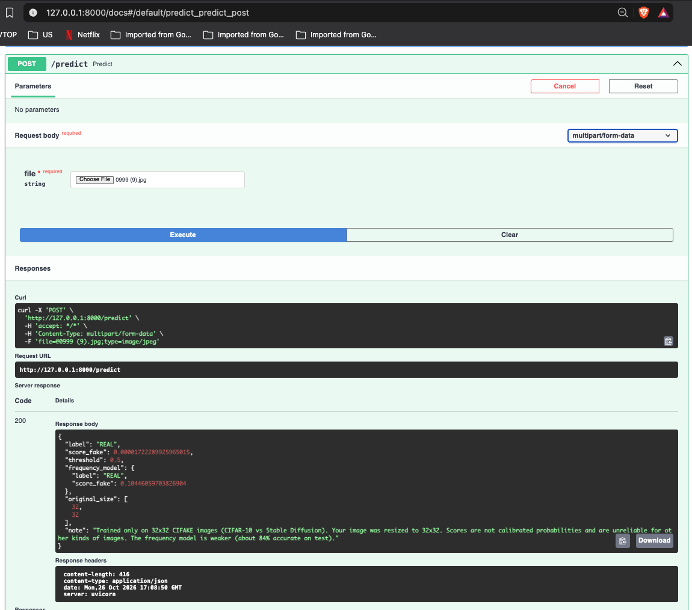

# FFT-Deep: Frequency-Aware Real vs AI-Generated Image Detection

A small, honest study of detecting AI-generated images on the CIFAKE dataset (CIFAR-10 photos vs Stable Diffusion images, 32×32). It covers data auditing, leakage control, baselines, a CNN, FFT (frequency) features, Grad-CAM and a FastAPI service.

Author: Aditya Dhamala

## Summary

- **Final model:** a CNN (3 blocks of 2 conv layers + batch norm, global average pooling, dropout, sigmoid output; 288,481 parameters) trained with Adam, early stopping, learning-rate reduction and horizontal-flip augmentation. **Test accuracy 96.34%, F1 0.9636, ROC-AUC 0.9938** on the official 20,000-image test set (threshold 0.5).
- **FFT result:** a model that sees only the FFT log-spectrum reaches **84.2%** test accuracy, so frequency information carries real signal. Fusing it with the image CNN did **not** beat the image-only CNN under identical training (94.7% vs 95.0%).
- **Data problem found and fixed:** 378 test images (all FAKE) were pixel-identical to training images. The duplicates were removed from the training set before training.
- **Scope:** results hold for this dataset only. See Limitations.

## Dataset and audit

CIFAKE (Bird & Lotfi, 2023): 120,000 images, 32×32, JPEG. Official split: 100,000 train (50,000 REAL / 50,000 FAKE) and 20,000 test (10,000 / 10,000). Source: https://www.kaggle.com/datasets/birdy654/cifake-real-and-ai-generated-synthetic-images

The audit (`src/fftdeep/data/audit.py`, output in `reports/data_audit.json`) found:

- All images are RGB JPEG 32×32, none corrupted.
- Hashing the decoded pixels found 1,336 duplicate groups, each with exactly two images. **378 span train and test (all FAKE)**, 920 are inside train, 38 inside test. No duplicate group contains both classes.
- REAL images are about 10 intensity levels brighter than FAKE on average (a possible shortcut; measured with a baseline below).

Cleaning (`src/fftdeep/data/splits.py`): remove the 378 train copies of test images and keep one image per fingerprint in train (1,298 FAKE images removed, 98,702 remain), then carve a stratified 20% validation set from train. The official test set is untouched (the 38 duplicate pairs inside it remain).

| Subset          | REAL   | FAKE   | Total  |
| --------------- | ------ | ------ | ------ |
| train           | 40,000 | 38,961 | 78,961 |
| validation      | 10,000 | 9,741  | 19,741 |
| test (official) | 10,000 | 10,000 | 20,000 |

A pytest checks that no pixel fingerprint appears in two subsets. Near-duplicates (crops, resizes) are not detected by exact hashing.

## Evaluation protocol

- Train teaches the model. Validation is used for early stopping, learning-rate reduction and model choice. **Test was used once**, after all choices were frozen. Threshold fixed at 0.5.
- Positive class = FAKE (label 1). Metrics: accuracy, precision, recall, specificity, F1, ROC-AUC, confusion matrix.
- Model pairs were compared on validation with McNemar's exact test.
- Everything uses one random seed (42). Differences below about 0.3 accuracy points are within noise (standard error about 0.15 points on 20,000 images).

## Baselines (validation)

| Baseline                        | Accuracy | AUC   |
| ------------------------------- | -------- | ----- |
| Always predict REAL             | 0.507    | n/a   |
| Logistic regression on mean RGB | 0.572    | 0.609 |

## Models

All use binary cross-entropy and Adam (learning rate 0.001), batch size 128, early stopping on validation loss (patience 5, best weights restored). Training ran on an Apple M1 Pro CPU (the Metal GPU plugin was about 3× slower, so it was removed).

| Model (validation, Keras)                    | Parameters | Accuracy   | AUC        |
| -------------------------------------------- | ---------- | ---------- | ---------- |
| Baseline CNN (video-style: 1 conv per block) | 93,377     | 0.9474     | 0.9878     |
| + learning-rate reduction                    | 93,377     | 0.9495     | 0.9899     |
| Deeper (2 convs per block + batch norm)      | 288,481    | 0.9514     | 0.9898     |
| **Deeper + learning-rate reduction (final)** | 288,481    | **0.9619** | **0.9933** |

The deeper model's validation curve was very jumpy until the learning rate was halved on plateaus (`ReduceLROnPlateau`, factor 0.5, patience 2).

## FFT features and fusion experiment

Motivation: prior work reports that up-sampling layers in GAN generators leave spectral distortions in generated images (Durall et al., 2020). The fakes in CIFAKE come from Stable Diffusion, a different kind of generator, so we test this idea instead of assuming it.

Frequency input: grayscale image → subtract the image mean (removes brightness) → 2D FFT → shift zero frequency to the centre → `log(1 + |F|)` → standardise each frequency with the **training-set** mean and standard deviation (no validation or test data used).

Three models share the same conv stack and training recipe, with **no augmentation** (a flip changes the spectrum, so flipping only the image would feed the two branches inconsistent inputs):

- image-only (288,481 parameters)
- FFT-only (287,905 parameters)
- fusion: two branches, features concatenated before the output layer (576,385 parameters)

On validation, image-only was better than fusion (McNemar: image right and fusion wrong on 559 images, the reverse on 439, p = 0.0002). On test the gap was small (see table). All three overfit quickly without augmentation, and fusion overfit the most. Fusion has twice the parameters, so capacity is a confound.

## Final test results (official test set, threshold 0.5)

| Model                                        | Accuracy   | Precision | Recall | Specificity | F1         | ROC-AUC    |
| -------------------------------------------- | ---------- | --------- | ------ | ----------- | ---------- | ---------- |
| Baseline CNN                                 | 0.9450     | 0.9422    | 0.9483 | 0.9418      | 0.9452     | 0.9884     |
| **Final CNN (deeper + LR reduction + flip)** | **0.9634** | 0.9606    | 0.9665 | 0.9604      | **0.9636** | **0.9938** |
| Image-only (no flip)                         | 0.9503     | 0.9345    | 0.9685 | 0.9321      | 0.9512     | 0.9910     |
| FFT-only                                     | 0.8420     | 0.8544    | 0.8244 | 0.8595      | 0.8391     | 0.9221     |
| Fusion (image + FFT)                         | 0.9470     | 0.9471    | 0.9469 | 0.9471      | 0.9470     | 0.9884     |

Validation and test accuracy differ by less than 0.4 points for every model (`reports/val_vs_test.csv`). Raw results: `reports/test_results.csv`.

For context, Gupta & McMahan (2025) report 90.30% (CNN) and 93.30% (CNN + FFT) on the same official test set. Their protocol differs (no duplicate cleaning reported, no validation set described), so the numbers are not directly comparable.



## Grad-CAM

Grad-CAM (`src/fftdeep/visualization/gradcam.py`, `notebooks/09_gradcam.ipynb`) on the final CNN, using the last convolutional block (8×8 feature map) and the pre-sigmoid score so confident predictions still have gradients. It explains the predicted class. It is an offline analysis and is **not part of the API**.



**Deletion check (500 test images):** hiding the 25% most-highlighted pixels lowered the model's confidence by 4.24 on average, while hiding 25% random pixels lowered it by 6.58. The maps therefore show where the CNN looks, but they are **not** a reliable explanation of why an image is judged fake. The maps are coarse (8×8 upsampled to 32×32).

## API

FastAPI service (`src/fftdeep/api/main.py`):

- `GET /health`: shows whether the models are loaded.
- `POST /predict`: upload an image file. It is resized to 32×32. The reply has the CNN label and fake score, plus the FFT-only model's label and score as a weaker second opinion. It returns scores only (no heat maps).

```bash
uv run uvicorn fftdeep.api.main:app --port 8000
# interactive page: http://127.0.0.1:8000/docs
curl -F "file=@some_image.png" http://127.0.0.1:8000/predict
```

### Example



Reply for one image from `data/raw/cifake/test/REAL/`:

```json
{
  "label": "REAL",
  "score_fake": 0.0000172,
  "threshold": 0.5,
  "frequency_model": { "label": "REAL", "score_fake": 0.1045 },
  "original_size": [32, 32],
  "note": "Trained only on 32x32 CIFAKE images (CIFAR-10 vs Stable Diffusion). Your image was resized to 32x32. Scores are not calibrated probabilities and are unreliable for other kinds of images. The frequency model is weaker (about 84% accurate on test)."
}
```

The CNN is very sure this image is real (fake score 0.00002). The frequency model agrees but is less sure.

The score is not a calibrated probability. The reply includes a note that the models were trained only on 32×32 CIFAKE images, so scores for other kinds of images are unreliable.

## Limitations

- One dataset: CIFAR-10 photos vs Stable Diffusion images at 32×32. No test on other generators, resolutions or real-world photos. Uploaded images are shrunk differently from how this dataset was made, so API scores for outside images are not trustworthy.
- The model may partly learn dataset-pipeline artefacts (resizing, JPEG compression) instead of generation artefacts. The data cannot separate the two. The same applies to the FFT result.
- Single training seed, no confidence intervals.
- Output scores are not calibrated (some are saturated at 1.0).
- Exact-hash deduplication only. 38 duplicate pairs remain inside the test set.
- Fusion was trained without augmentation and has twice the parameters, so "fusion vs the final CNN" is not like-for-like. Fusion with consistent augmentation was not tested.
- Grad-CAM failed a simple deletion check (see above) and is not available in the API.
- Brightness alone separates the classes somewhat (57% accuracy), so part of the task is easier than it looks.

## Reproduce

```bash
uv sync
# download CIFAKE from Kaggle into data/raw/cifake  (folders train/REAL, train/FAKE, test/REAL, test/FAKE)
uv run python -m fftdeep.data.audit data/raw/cifake
uv run python -m fftdeep.data.splits data/raw/cifake
uv run python -m fftdeep.training.train_cnn --variant baseline
uv run python -m fftdeep.training.train_cnn --variant deeper --reduce-lr --tag lrdecay
for m in image freq both; do uv run python -m fftdeep.training.train_fusion --mode $m; done
cp data/processed/spec_stats.npz models/spec_stats.npz
uv run pytest -q
```

Trained `.keras` model files are not stored in Git (see `.gitignore`), so run the training commands to recreate them. Python 3.11, TensorFlow 2.21, Keras 3.15, managed with `uv`.

## Project structure

```
src/fftdeep/
  data/            audit, deduplicated split, array cache
  frequency/       FFT log-spectrum features
  models/          CNN builders (image, FFT, fusion)
  training/        training scripts
  evaluation/      metrics and plots
  visualization/   Grad-CAM
  api/             FastAPI service
notebooks/         01 exploration ... 09 Grad-CAM
reports/           audit, histories, results tables, figures
tests/             data leakage, FFT conventions, API
```

## References

- Bird, J. J. & Lotfi, A. (2023). CIFAKE: Image Classification and Explainable Identification of AI-Generated Synthetic Images. [arXiv:2303.14126](https://arxiv.org/abs/2303.14126).
- Gupta, P. & McMahan, L. (2025). Optimizing AI image detection using a Convolutional Neural Network model with Fast Fourier Transform. Journal of Emerging Investigators, 8. [doi:10.59720/24-270](https://doi.org/10.59720/24-270)
- Durall, R., Keuper, M. & Keuper, J. (2020). Watch Your Up-Convolution: CNN Based Generative Deep Neural Networks Are Failing to Reproduce Spectral Distributions. CVPR 2020. [arXiv:2003.01826](https://arxiv.org/abs/2003.01826)
